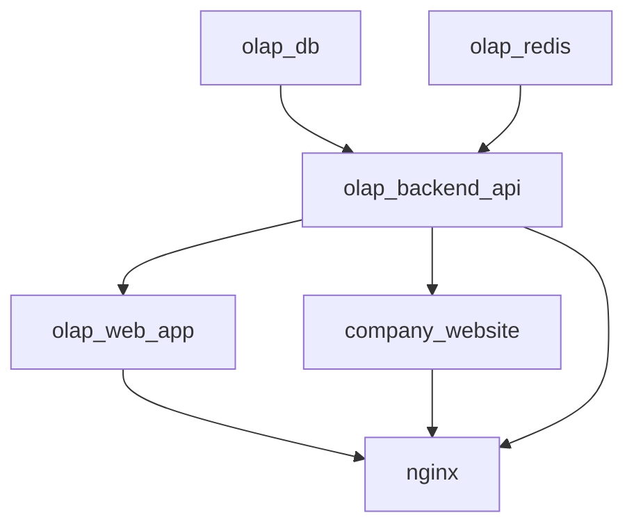

# ZedLendingCorp — Production Deployment Process

> Generated from knowledge graph analysis (`graphify query "production deployment docker nginx"`) and source code inspection.  
> **Repository:** `LMS_NextJS_Django_Docker` | **Commit:** `edc11101` | **Graph Commit:** `a8f2ba6c`

---

## Overview

ZedLendingCorp uses a **standalone production Docker Compose file** (`docker-compose.prod.yml`) that does NOT merge with the development compose file. All three application tiers build from their respective `Dockerfile.prod` files. Nginx terminates TLS and is the only service exposed to the host on ports 80/443.

**Deploy Command:**
```bash
docker compose --env-file .env.prod -f docker-compose.prod.yml up --build -d
```

---

## Service Architecture

```
Internet (80/443)
       │
       ▼
┌──────────────────┐
│     NGINX        │ ◄── TLS Termination (Let's Encrypt certs in ./letsencrypt)
│  (nginx:1.27)    │
└────────┬─────────┘
         │
    ┌────┼────┬───────────────────────┐
    ▼    ▼    ▼                       ▼
company_  olap_  olap_          (internal only)
website   web    backend
(app)     (app)  (api)
```

### Service Definitions

| Service | Image | Build Context | Port | Health Check | Key Dependencies |
| :--- | :--- | :--- | :--- | :--- | :--- |
| **nginx** | `nginx:1.27-alpine` | N/A | 80, 443 (TCP/UDP) | N/A (entrypoint) | All 3 app services (healthy) |
| **company_website** | `company_website:v1.0` | `./company_website/Dockerfile.prod` | 3001 | `GET /api/health` | — |
| **olap_web_app** | `olap_web_app:v1.0` | `./olap_web_app/Dockerfile.prod` | 3000 | `GET /login` | `olap_backend_api:healthy` |
| **olap_backend_api** | `olap_backend_api:v1.0` | `./olap_backend_api/Dockerfile.prod` | 8000 | `GET /admin/login/` | `olap_db:healthy`, `olap_redis:healthy` |
| **olap_db** | `postgres:15-alpine` | N/A | 5432 (internal) | `pg_isready` | — |
| **olap_redis** | `redis:7-alpine` | N/A | 6379 (internal) | `redis-cli ping` | — |

### Common Configuration (All Services)
```yaml
x-common-config: &common-config
  restart: unless-stopped
  networks: [app_network]
  logging:
    driver: "json-file"
    options:
      max-size: "10m"
      max-file: "3"
```

---

## Nginx Configuration (TLS Termination & Reverse Proxy)

**File:** `nginx/nginx.conf` → includes `nginx/conf.d/*.conf`

### Virtual Hosts (`nginx/conf.d/sites.conf`)

| Domain | Upstream | SSL Cert | Purpose |
| :--- | :--- | :--- | :--- |
| `api.zedpaala.site` | `http://olap_backend` | `/etc/letsencrypt/live/zedpaala.site/fullchain.pem` | Django REST API |
| `app.zedpaala.site` | `http://olap_web` | Same wildcard cert | LMS Web App (Next.js) |
| `zedpaala.site` / `www.zedpaala.site` | `http://comp_web` | Same wildcard cert | Company Website |

### Key Nginx Features
- **HTTP → HTTPS redirect** for all hosts (port 80)
- **ACME challenge** support at `/.well-known/acme-challenge/` for Let's Encrypt renewal
- **HTTP/2** enabled on all 443 listeners
- **Proxy headers** forwarded: `Host`, `X-Real-IP`, `X-Forwarded-For`, `X-Forwarded-Proto`
- **Static asset caching** for Next.js: `/_next/static/` → `Cache-Control: public, max-age=31536000, immutable`
- **Client max body size**: 20MB (API uploads)
- **Proxy read timeout**: 300s (long-running API requests)

---

## Django Production Settings

### Settings Hierarchy
```
config/settings/base.py (250+ lines)
       ▲
       │ imports
       │
config/settings/production.py (3 lines)
```

### `production.py`
```python
from .base import *
DEBUG = False
```

### Critical Production Settings (`base.py`)

| Setting | Value / Source |
| :--- | :--- |
| **DEBUG** | `False` (overridden in `production.py`) |
| **SECRET_KEY** | `DJANGO_SECRET_KEY` env var (required) |
| **ALLOWED_HOSTS** | `DJANGO_ALLOWED_HOSTS` env var (comma-separated) |
| **SECURE_PROXY_SSL_HEADER** | `('HTTP_X_FORWARDED_PROTO', 'https')` — trusts nginx TLS termination |
| **CSRF_TRUSTED_ORIGINS** | `DJANGO_CSRF_TRUSTED_ORIGINS` env var |
| **CORS_ALLOWED_ORIGINS** | `DJANGO_CORS_ALLOWED_ORIGINS` env var (default: localhost:3000,3001) |
| **CORS_ALLOW_CREDENTIALS** | `True` |

### Database (PostgreSQL 15)
```python
DATABASES = {
    'default': {
        'ENGINE': 'django.db.backends.postgresql',
        'NAME': os.getenv('POSTGRES_DB'),
        'USER': os.getenv('POSTGRES_USER'),
        'PASSWORD': os.getenv('POSTGRES_PASSWORD'),
        'HOST': os.getenv('POSTGRES_HOST'),
        'PORT': os.getenv('POSTGRES_PORT'),
        'OPTIONS': {
            'connect_timeout': 5,
            'options': '-c search_path=public,django'
        },
        'CONN_MAX_AGE': 300,  # Persistent connections
        'TEST': {'NAME': 'test_lms_db'},
    }
}
```

### Authentication & JWT
- **Custom User Model**: `accounts.User` (email as USERNAME_FIELD)
- **JWT**: 60-min access / 7-day refresh tokens
- **Rotation**: `ROTATE_REFRESH_TOKENS=True`, `BLACKLIST_AFTER_ROTATION=True`
- **Algorithm**: HS256 signed with `SECRET_KEY`

### Static & Media Files
```python
STATIC_URL = '/static/'
STATIC_ROOT = BASE_DIR / 'staticfiles'
STATICFILES_DIRS = [BASE_DIR / 'static']

STORAGES = {
    'default': {'BACKEND': 'django.core.files.storage.FileSystemStorage'},
    'staticfiles': {'BACKEND': 'whitenoise.storage.CompressedStaticFilesStorage'},
}

MEDIA_URL = 'media/'
MEDIA_ROOT = BASE_DIR / 'media'
```

### Celery & Redis
```python
CELERY_BROKER_URL = os.getenv('CELERY_BROKER_URL')
CELERY_RESULT_BACKEND = os.getenv('CELERY_RESULT_BACKEND')
CELERY_ACCEPT_CONTENT = ['json']
CELERY_TASK_SERIALIZER = 'json'
CELERY_RESULT_SERIALIZER = 'json'
CELERY_TIMEZONE = 'UTC'
```

### Email & SMS
- **Email**: SMTP via `EMAIL_HOST`, `EMAIL_PORT`, `EMAIL_USE_TLS`, credentials
- **SMS**: Twilio (`TWILIO_*`) and Infobip (`INFOBIP_*`) — dual provider support

### Verification Timeouts
- **Email verification**: 1 hour (`EMAIL_VERIFICATION_TIMEOUT = 3600`)
- **Phone verification**: 5 minutes (`PHONE_VERIFICATION_TIMEOUT = 300`)

---

## Dependency Startup Order



**Health Check Commands:**
| Service | Command |
| :--- | :--- |
| `olap_db` | `pg_isready -U ${POSTGRES_USER:-postgres}` |
| `olap_redis` | `redis-cli -a ${REDIS_PASSWORD} ping` |
| `olap_backend_api` | `curl -f http://localhost:8000/admin/login/` |
| `olap_web_app` | `fetch('http://localhost:3000/login')` |
| `company_website` | `fetch('http://localhost:3001/api/health')` |

---

## Environment & Secrets

### `.env.prod` (Required Variables)
```bash
# Django
DJANGO_SECRET_KEY=...
DJANGO_ALLOWED_HOSTS=api.zedpaala.site,app.zedpaala.site,zedpaala.site,www.zedpaala.site
DJANGO_CSRF_TRUSTED_ORIGINS=https://api.zedpaala.site,https://app.zedpaala.site,https://zedpaala.site
DJANGO_CORS_ALLOWED_ORIGINS=https://app.zedpaala.site,https://zedpaala.site

# Database
POSTGRES_DB=lms_db
POSTGRES_USER=postgres
POSTGRES_PASSWORD=...
POSTGRES_HOST=olap_db
POSTGRES_PORT=5432

# Redis
REDIS_PASSWORD=...
REDIS_HOST=olap_redis
REDIS_PORT=6379
CELERY_BROKER_URL=redis://:${REDIS_PASSWORD}@olap_redis:6379/0
CELERY_RESULT_BACKEND=redis://:${REDIS_PASSWORD}@olap_redis:6379/1

# Email
EMAIL_HOST=...
EMAIL_PORT=587
EMAIL_USE_TLS=True
EMAIL_HOST_USER=...
EMAIL_HOST_PASSWORD=...
DEFAULT_FROM_EMAIL=...

# SMS (Twilio)
TWILIO_ACCOUNT_SID=...
TWILIO_AUTH_TOKEN=...
TWILIO_PHONE_NUMBER=...

# SMS (Infobip - alternative)
INFOBIP_API_KEY=...
INFOBIP_API_BASE_URL=...
INFOBIP_SENDER_ID=...

# Build args (Next.js)
DJANGO_API_HOST=https://api.zedpaala.site
```

> ⚠️ **Important**: `.env.prod` must NOT contain `${...}` inside values — Docker Compose interpolates them.

### Let's Encrypt Certificates
- Stored in `/etc/letsencrypt/` on host (absolute path)
- Mounted read-only into nginx: `- /etc/letsencrypt:/etc/letsencrypt:ro`
- Wildcard cert for `*.zedpaala.site` used by all three virtual hosts

---

## SSL Certificate Setup

### What SSL Certificates Do

SSL certificates provide three critical functions:

1. **Encryption** — All data between browser and server is encrypted, preventing interception of sensitive information (passwords, loan applications, payment data).
2. **Authentication** — Proves the server's identity, preventing man-in-the-middle attacks where a fake server impersonates the real one.
3. **Trust & Credibility** — Browsers display the padlock icon and mark the site as secure. Required for PCI compliance and payment processing.

### Certificate Directory Structure

Certbot (Let's Encrypt client) stores certificates at `/etc/letsencrypt/` on the host:

```
/etc/letsencrypt/
├── live/
│   └── zedpaala.site/          # Named after your domain
│       ├── fullchain.pem       # ← Your cert + intermediates (nginx needs this)
│       ├── privkey.pem         # ← Your private key
│       ├── cert.pem            # ← Your certificate only
│       ├── chain.pem           # ← Intermediate certificates only
│       └── README             # ← Instructions
├── archive/
│   └── zedpaala.site/         # Old/expired certs (backup)
│       ├── fullchain1.pem
│       ├── privkey1.pem
│       └── ...
├── renewal/
│   └── zedpaala.site.conf     # Renewal configuration
└── keys/
    └── privkey1.pem            # Legacy key storage
```

### Step 1: Install Certbot

```bash
sudo apt-get update
sudo apt-get install -y certbot
```

### Step 2: Generate Certificates

```bash
sudo certbot certonly --standalone \
  -d zedpaala.site \
  -d www.zedpaala.site \
  -d api.zedpaala.site \
  -d app.zedpaala.site \
  --email admin@zedpaala.site \
  --agree-tos \
  --non-interactive
```

> **Note:** `--standalone` mode temporarily binds to port 80. Ensure no other service (including nginx) is running on port 80 during this step.

### Step 3: Verify Certificates

```bash
ls -la /etc/letsencrypt/live/zedpaala.site/
```

Expected output:
```
fullchain.pem -> ../../archive/zedpaala.site/fullchain1.pem
privkey.pem   -> ../../archive/zedpaala.site/privkey1.pem
cert.pem      -> ../../archive/zedpaala.site/cert1.pem
chain.pem     -> ../../archive/zedpaala.site/chain1.pem
```

### Step 4: Fix docker-compose.prod.yml Mount Path

**Critical:** The mount must use the **absolute host path**, not a relative path:

```yaml
# WRONG (relative path - certs not found)
volumes:
  - ./letsencrypt:/etc/letsencrypt:ro

# CORRECT (absolute path)
volumes:
  - /etc/letsencrypt:/etc/letsencrypt:ro
```

Fix with sed:
```bash
sed -i 's|\./letsencrypt:/etc/letsencrypt:ro|/etc/letsencrypt:/etc/letsencrypt:ro|' docker-compose.prod.yml
```

### Step 5: Restart Nginx

```bash
docker compose --env-file .env.prod -f docker-compose.prod.yml restart nginx
```

### Step 6: Verify Nginx Starts Successfully

```bash
docker compose --env-file .env.prod -f docker-compose.prod.yml logs nginx
```

No more `BIO_new_file() failed` errors = success.

---

### Troubleshooting: Common SSL Errors

#### Error: `cannot load certificate "/etc/letsencrypt/live/zedpaala.site/fullchain.pem": BIO_new_file() failed`

**Root Cause:** The mount path in `docker-compose.prod.yml` uses a relative path (`./letsencrypt/`) instead of the absolute path (`/etc/letsencrypt/`).

**Fix:**
```bash
sed -i 's|\./letsencrypt:/etc/letsencrypt:ro|/etc/letsencrypt:/etc/letsencrypt:ro|' docker-compose.prod.yml
docker compose --env-file .env.prod -f docker-compose.prod.yml restart nginx
```

#### Error: Certificates exist but nginx still fails

**Diagnosis:** Check if symlinks are broken (archive files missing):
```bash
ls -la /etc/letsencrypt/archive/zedpaala.site/
cat /etc/letsencrypt/live/zedpaala.site/fullchain.pem 2>&1 | head -5
```

**Fix:** Regenerate certs:
```bash
sudo rm /etc/letsencrypt/live/zedpaala.site/*
sudo certbot certonly --standalone \
  -d zedpaala.site -d www.zedpaala.site -d api.zedpaala.site -d app.zedpaala.site \
  --email admin@zedpaala.site --agree-tos --non-interactive --force
```

#### Error: Port 80 already in use during cert generation

**Fix:** Stop nginx first, then run certbot, then restart nginx:
```bash
docker compose --env-file .env.prod -f docker-compose.prod.yml stop nginx
sudo certbot certonly --standalone \
  -d zedpaala.site -d www.zedpaala.site -d api.zedpaala.site -d app.zedpaala.site \
  --email admin@zedpaala.site --agree-tos --non-interactive
docker compose --env-file .env.prod -f docker-compose.prod.yml start nginx
```

#### Permissions errors

**Fix:**
```bash
sudo chown -R $USER:$USER /etc/letsencrypt
sudo chmod -R 755 /etc/letsencrypt
```

---

### Auto-Renewal

Let's Encrypt certificates expire every 90 days. Set up auto-renewal:

```bash
# Add cron job (runs twice daily)
sudo crontab -e
# Add: 0 12 * * * /usr/bin/certbot renew --quiet
```

Verify renewal works:
```bash
sudo certbot renew --dry-run
```

---

## Persistent Volumes

| Volume | Mount Point | Purpose |
| :--- | :--- | :--- |
| `postgres_data` | `/var/lib/postgresql/data` | PostgreSQL data directory |
| `redis_data` | `/data` | Redis persistence (AOF/RDB) |
| `static_volume` | `/app/staticfiles` | Django collected static files (WhiteNoise) |
| `backend_media` | `/app/media` | User-uploaded media files |

---

## Production Hardening Checklist

| Area | Implementation |
| :--- | :--- |
| **TLS** | Terminated at nginx (TLS 1.2/1.3), HSTS via `SECURE_PROXY_SSL_HEADER` |
| **Static Files** | WhiteNoise `CompressedStaticFilesStorage` with gzip/brotli, immutable caching |
| **DB Connections** | `CONN_MAX_AGE=300` (5-min persistent), 5s connect timeout |
| **Security Headers** | `CSRF_TRUSTED_ORIGINS`, `CORS_ALLOW_CREDENTIALS`, `X-Frame-Options` (middleware) |
| **Logging** | JSON-file driver, 10MB max, 3-file rotation |
| **Container Restart** | `unless-stopped` on all services |
| **Resource Limits** | `shm_size: 256mb` for PostgreSQL |
| **Network Isolation** | Single `app_network` bridge, no host ports except nginx |
| **Secrets** | All via `.env.prod`, never baked into images |

---

## Verification Commands

```bash
# Check all services healthy
docker compose --env-file .env.prod -f docker-compose.prod.yml ps

# Test API endpoint
curl -f https://api.zedpaala.site/admin/login/

# Test Web App
curl -f https://app.zedpaala.site/login

# Test Company Website
curl -f https://zedpaala.site/api/health

# View logs
docker compose --env-file .env.prod -f docker-compose.prod.yml logs -f nginx
docker compose --env-file .env.prod -f docker-compose.prod.yml logs -f olap_backend_api

# Scale backend (if needed)
docker compose --env-file .env.prod -f docker-compose.prod.yml up --scale olap_backend_api=3 -d
```

---

## Knowledge Graph References

- **Community**: `olap_backend_api service (prod, production settings)` (Community 1)
- **God Nodes**: `cn()` (161 edges), `TailwindConfigGenerator` (60), `DesignSystemGenerator` (48)
- **Graph File**: `graphify-out/graph.json` (2,826 nodes, 4,354 edges, 291 communities)
- **Query Used**: `graphify query "production deployment docker nginx"`

---

*Document generated on 2026-09-29 from graphify knowledge graph and source code analysis.*

---

## Fix Options
Option 1: Issue Let's Encrypt Certificates (Recommended)
Run certbot on your VM to generate the certs:
# Install certbot
sudo apt-get update && sudo apt-get install -y certbot

# Generate certs (standalone mode, port 80 must be free)
sudo certbot certonly --standalone \
-d zedpaala.site \
-d www.zedpaala.site \
-d api.zedpaala.site \
-d app.zedpaala.site \
--email your@email.com \
--agree-tos \
--non-interactive

# Symlink to the expected path
sudo mkdir -p /etc/letsencrypt/live/zedpaala.site
sudo ln -sf /etc/letsencrypt/live/zedpaala.site/fullchain.pem \
/etc/letsencrypt/live/zedpaala.site/fullchain.pem
Then restart nginx:
docker compose --env-file .env.prod -f docker-compose.prod.yml restart nginx